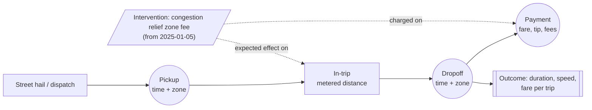
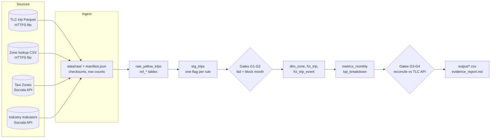
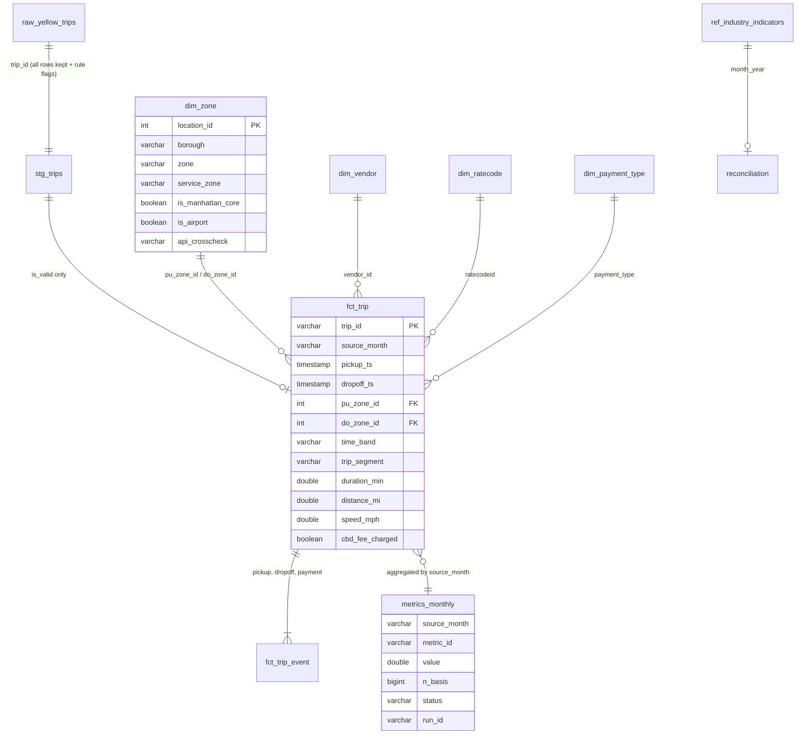

# Workflow and data model

## Trip workflow (one yellow-cab trip)

Entities: **zone** (where), **vendor / TPEP provider** (who recorded it), **rate code** and **payment type** (how it was charged).
Events: pickup → dropoff → payment (`fct_trip_event`). Outcome: duration, distance, speed (`fct_trip`).
Intervention: `cbd_congestion_fee > 0` marks trips charged the congestion toll. The column is absent before 2025, so it is `null`, not `0`.

## Pipeline

## Relational model (DuckDB, `warehouse/tlc.duckdb`)

| Table | Grain | Built by | Rerun behaviour |
|---|---|---|---|
| `raw_yellow_trips` | raw row | `load.py` | month replaced in one transaction |
| `stg_trips` | raw row + 15 rule flags, `is_valid`, `exclusion_rule` | `validate.py` | month replaced |
| `validation_results` | month × rule | `validate.py` | month replaced |
| `gate_results` | month × gate | `gates.py` | month replaced |
| `dim_zone` | LocationID | `model.py` | rebuilt each run |
| `fct_trip` | validated trip | `model.py` | month replaced |
| `fct_trip_event` (view) | trip × event | `model.py` | view |
| `metrics_monthly`, `kpi_breakdown`, `reconciliation` | month × metric / band / segment | `metrics.py` | month replaced |
| `pipeline_runs`, `pipeline_stage_log` | run / run × month × stage | `__main__.py` | append-only audit log |
